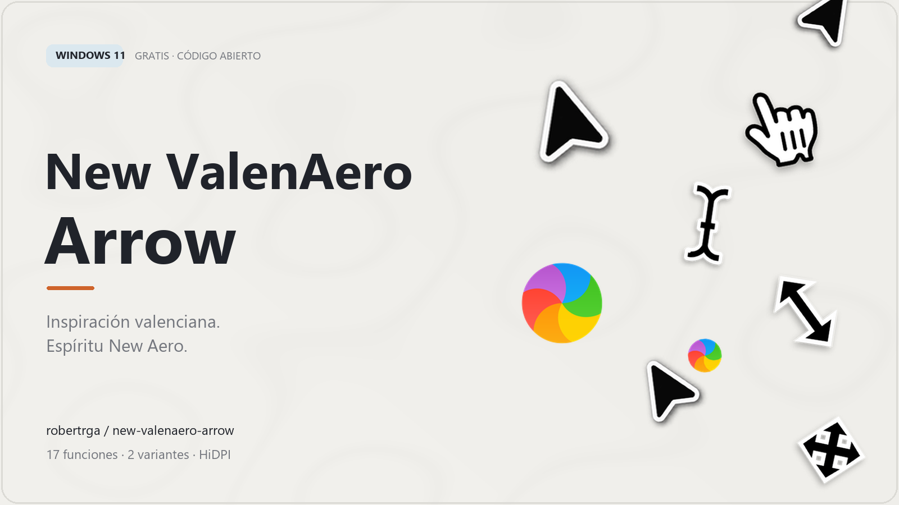
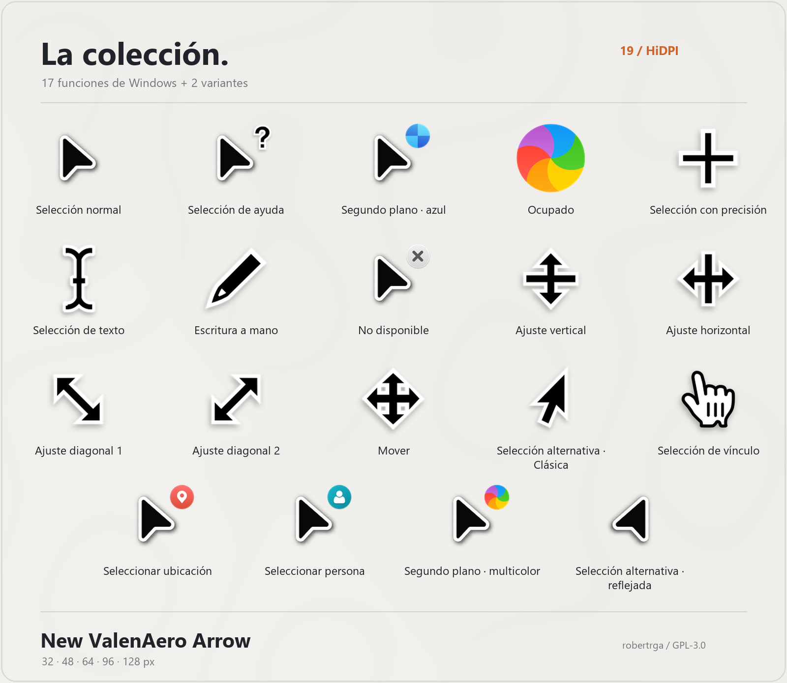
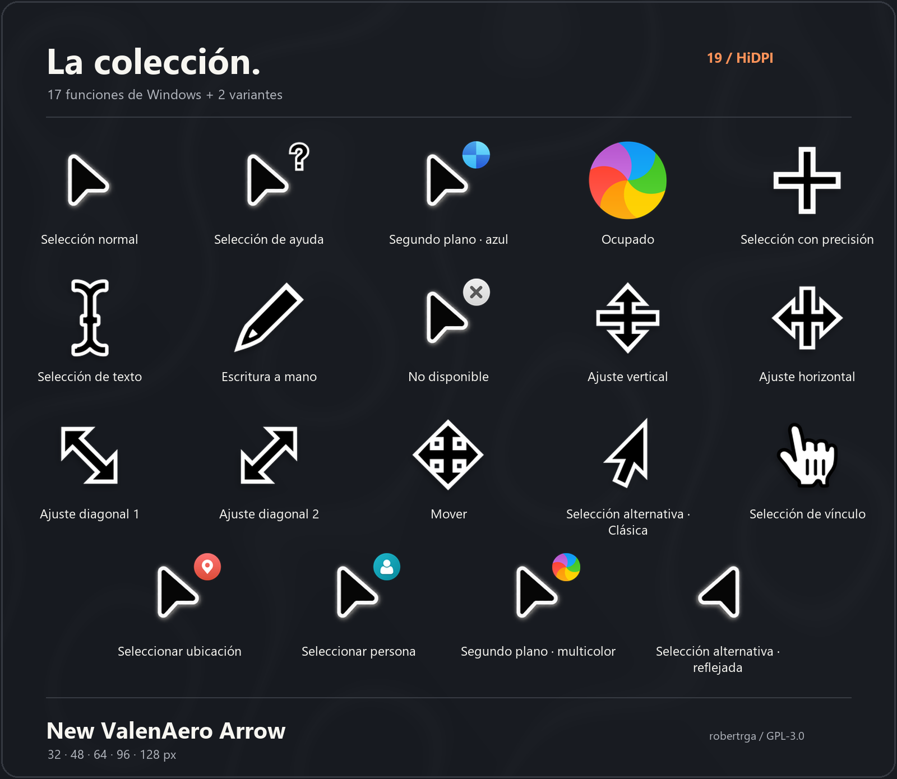
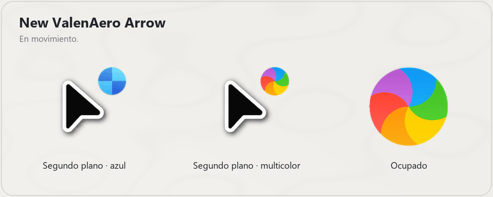
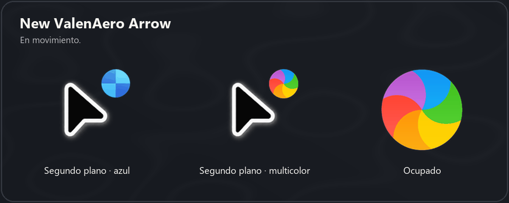

# New ValenAero Arrow

<picture>
  <source media="(prefers-color-scheme: dark)" srcset="showroom/New_ValenAero_Arrow_Header_es_dark.png">
  
</picture>

**Inspiración valenciana. Espíritu New Aero.**

19 archivos para 17 funciones de Windows y dos variantes adicionales. Los cursores con flecha de ayuda, segundo plano, no disponible, ubicación y persona utilizan la flecha propia. Selección alternativa ofrece una flecha clásica o la flecha propia reflejada, con hotspot también reflejado.

Para instalar después de revisar: extrae la carpeta completa, clic derecho en New_ValenAero_Arrow_Install.inf > Mostrar más opciones > Instalar. Registra cuatro esquemas, sin aplicar ninguno. Después elige uno en Propiedades del mouse > Punteros. Puedes regresar a tu esquema anterior desde ese panel.

Cuatro combinaciones: segundo plano azul/multicolor y selección alternativa clásica/reflejada. Ver README.md para créditos, licencia y comprobaciones. No se ha instalado ni aplicado nada durante la preparación.
