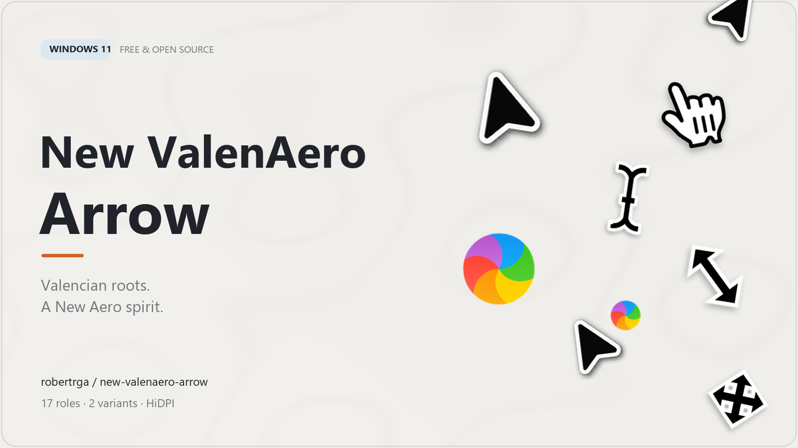
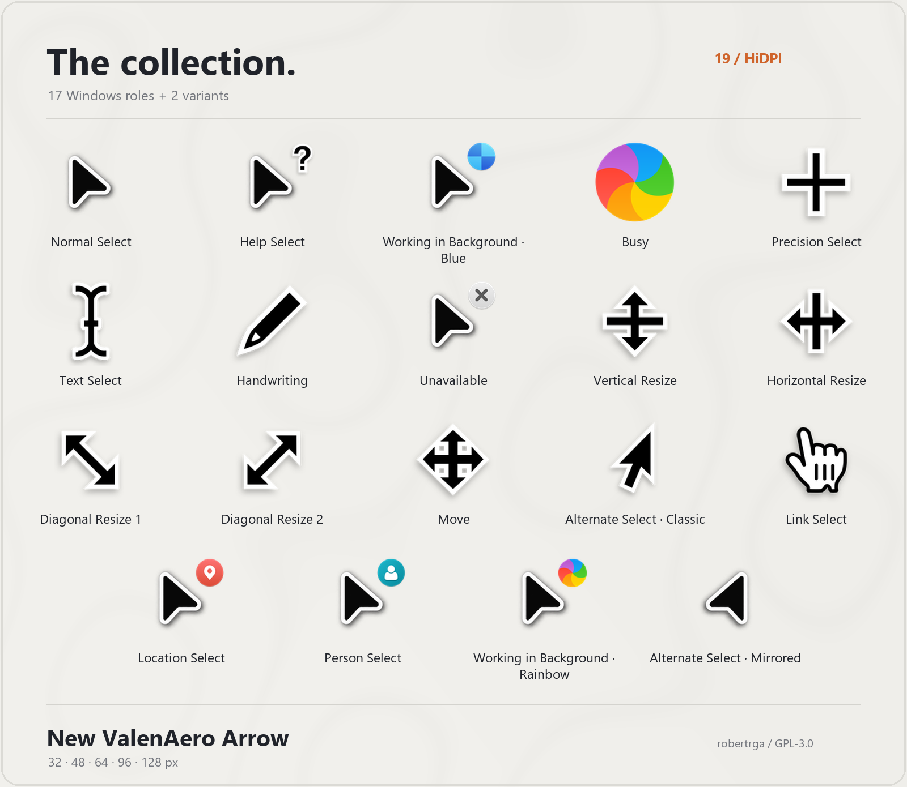
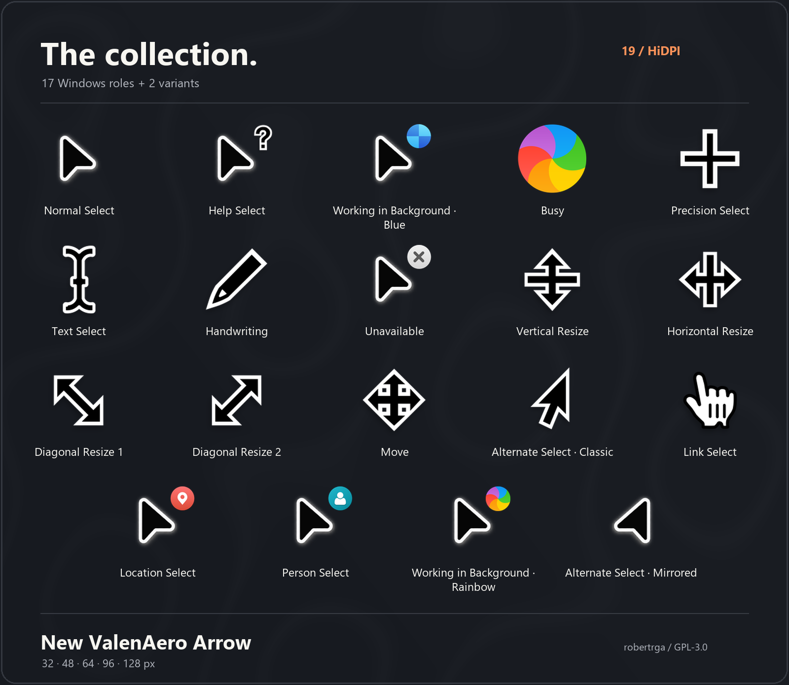
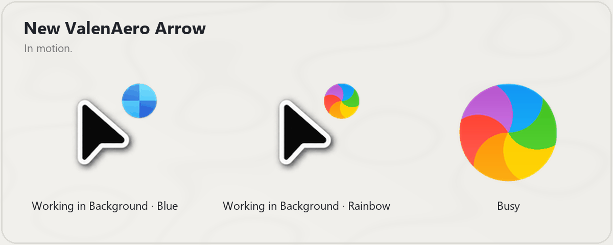
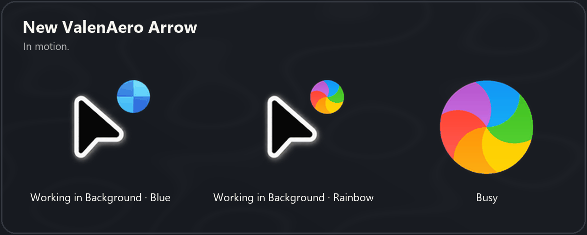

# New ValenAero Arrow

<picture>
  <source media="(prefers-color-scheme: dark)" srcset="showroom/New_ValenAero_Arrow_Header_en_dark.png">
  
</picture>

**Valencian roots. A New Aero spirit.**

[Español](LEEME.md) · [Cursor files](cursors/) · [Showroom](showroom/) · [License](LICENSE)

A free and open-source cursor theme for Windows, built around a compact black arrow, a white outline and a subtle grey halo.

17 Windows cursor roles, plus two optional variants. Five resolutions: 32, 48, 64, 96 and 128 px. The normal cursor is an unmodified copy of the original file. Help, both background animations, unavailable, location and person use the custom arrow. The custom alternate is its horizontal mirror with a mirrored hotspot.

## Showroom

[Spanish showroom, light](showroom/New_ValenAero_Arrow_Showroom_es_light.png) · [Spanish showroom, dark](showroom/New_ValenAero_Arrow_Showroom_es_dark.png) · [Spanish animations, light](showroom/New_ValenAero_Arrow_Animations_es_light.gif) · [Spanish animations, dark](showroom/New_ValenAero_Arrow_Animations_es_dark.gif)

## Variants

* Working in Background: blue disc or rainbow Busy wheel.
* Alternate Select: classic right arrow or mirrored custom arrow.

## Installation

Extract the complete folder. Right-click `New_ValenAero_Arrow_Install.inf` > Show more options > Install. This copies the cursors and registers four schemes; it does not activate one. Open Mouse Properties > Pointers, choose a `New ValenAero Arrow` scheme and Apply. Choose the previous scheme to restore its appearance.

The four schemes combine Blue/Rainbow with Apple Alternate/Custom Alternate. The filenames also allow individual manual selection.

## Validation

Windows loaded all 19 files at all five sizes and confirmed their hotspots (95 checks). DrawIconEx rendered 40 distinct frames for each of the three animations. The INF passed the Windows parser; it was not executed. ANI timing follows upstream `win_delay=1`: 1/60 s per frame. GIF previews approximate it using the GIF format's 10 ms time units. No system settings were changed during generation.

## Credits and source

Apple cursor SVGs: [ful1e5/apple_cursor](https://github.com/ful1e5/apple_cursor), revision `fe044a42b4e9cea16ea762d2ed9004f6d7b35543`, GPL-3.0. Original SVG sources and configuration are in `sources/`. Changes include custom-arrow compositions, an alternate mirrored arrow, multi-resolution Windows encoding and bilingual showroom assets. The custom arrow was supplied by the repository owner. This project is not affiliated with Apple.

The source artwork and these adaptations are distributed under GPL-3.0; see `LICENSE`.

## Build from source (Windows)

Requires Python 3.11+, Pillow, NumPy, Node.js and sharp. From this folder, install the dependencies with `npm install` and `python -m pip install Pillow numpy`, then run `npm run render` and `python scripts/build.py`. This rebuilds cursor files, showroom assets and the ZIP in the parent folder. The validation uses Windows APIs without applying any cursor settings.
